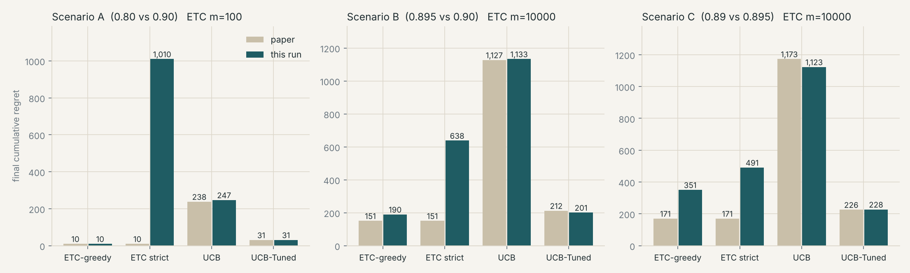
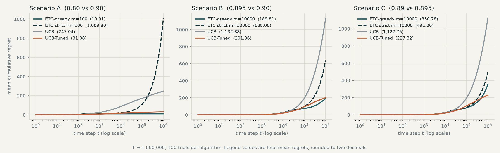

# DRL Assignment I, Group 6: bandit regret experiments

Experiments for the paper analysed in this assignment:

> Wolf, E. (2025). *A Framework for Fair Evaluation of Variance-Aware Bandit Algorithms.* arXiv:2510.27001.
> Authors' paper-linked framework version (Bandit Playground): https://github.com/eelisee/bandit_playground/tree/ab0e657070c41089ed37d9795f297d067bd84903

BITS Pilani WILP, M.Tech AI/ML, Deep Reinforcement Learning, Assignment I, Group 6.

| Member | BITS ID |
|---|---|
| Ashok Kumar K S | 2025AG05302 |
| Nithyasree A | 2025AG05607 |
| Nallajala Saibhargav | 2025AG05608 |
| Arjun Balaji | 2025AG05609 |

## What this repository contains

This repository contains the experiment code, dependencies, saved result tables and generated plots. Use the setup commands below to run and verify the experiments.

The paper compares eight bandit algorithms on three two-armed Bernoulli scenarios. This
repository partially reproduces ETC, UCB and UCB-Tuned using the paper's scenarios, horizon T = 1,000,000
steps, 100 independent trials and ETC exploration lengths m = 10 to 100,000, and places the
resulting regret next to the values printed in the paper's Tables 3 to 5. ETC is simulated in
two forms, described below, because the paper's text and the Bandit Playground code describe
slightly different procedures.

This is a partial reproduction of three algorithms and selected regret metrics. Our arm order
is randomized per trial, rather than exhaustively evaluated for each permutation. Random
streams and checkpoints differ; reward distributions, VaR and reward-variance tests are not
reproduced. The paper contributes an evaluation framework for existing algorithms.

| File | Purpose |
|---|---|
| `bandit_sim.py` | Simulation of ETC, ETC-greedy, UCB and UCB-Tuned (all trials run together as NumPy arrays) |
| `run_experiment.py` | Runs scenarios A, B, C and writes the tables in `results/` |
| `make_plots.py` | Draws `results/regret_curves.png` and `results/final_regret_vs_paper.png` |
| `verify_implementation.py` | Checks the simulation against a normal approximation and independent plain-loop references |
| `results/` | `summary.csv`, `comparison.csv`, `etc_expected.csv`, `raw_results.json`, figures |

## Setup and run

```bash
pip install -r requirements.txt        # numpy, matplotlib
python3 verify_implementation.py       # about a minute, prints PASS/FAIL per check
python3 run_experiment.py              # full horizon for our selected methods; writes results/
python3 run_experiment.py --quick      # T = 100,000, 20 trials; writes results_quick/
python3 make_plots.py                  # figures from results/
```

On Windows, use `python` if `python3` is not available. Quick runs use a shorter horizon;
their paper-reference columns are not like-for-like final comparisons. Use the preserved
full-horizon `results/` for reported comparisons. To plot quick outputs, pass their directory
explicitly: `python3 make_plots.py results_quick`.

Random seeds are fixed (`SEED = 42`); repeatability also depends on code and library versions.
The committed results come from a full run on 11 October 2026 with Python 3.14.5 and
NumPy 2.4.6. All 36 main summary rows, 20 paper-comparison rows and 36 mean regret curves
matched the previously saved results exactly. The verifier passed all 26 checks.

Five auxiliary strict-ETC Monte Carlo estimates differed slightly from the historical
output, within the reported sampling uncertainty. The original producing environment was
not recorded, so the cause of those differences is unestablished. The tables below use
the fresh committed estimates. `results/raw_results.json` records the generation time,
seeds, Python/NumPy versions, implementation version, source hashes and reproduction scope.

## Setting

| Scenario | Arm means (p1, p2) | Gap | Variance of the arms (rounded to 3 decimals) |
|---|---|---|---|
| A | 0.80, 0.90 | 0.100 | 0.160, 0.090 |
| B | 0.895, 0.90 | 0.005 | 0.094, 0.090 |
| C | 0.89, 0.895 | 0.005 | 0.098, 0.094 |

Rewards are Bernoulli. Regret is the cumulative pseudo-regret R_t = sum over k of (Q* - Q_(A_k)).

| Algorithm | Rule at step t (T_a = pulls of arm a so far) |
|---|---|
| ETC(m) | Pull each arm m times. After step 2m the arm with the larger empirical mean is pulled for the rest of the horizon (Wolf, Section 2.2) |
| ETC-greedy(m) | Pull each arm m times. After step 2m, at every step pull the arm with the larger empirical mean; the estimates keep updating, so the choice can change later. This is the procedure in the Bandit Playground ETC code |
| UCB | Pull the arm with the largest  Q_a + sqrt(2 ln t / T_a) |
| UCB-Tuned | Pull the arm with the largest  Q_a + sqrt((ln t / T_a) * min(1/4, V_a)),  V_a = mean(X^2) - Q_a^2 + sqrt(2 ln t / T_a) |

The better arm is placed at index 0 or 1 at random in every trial. This removes index
favouritism in expectation; finite trial counts need not balance both orders exactly.

## Results (T = 1,000,000, 100 trials)

The CSV files are the canonical numerical record. Tables and plots display rounded values;
use the stored CSV precision when comparing results or recomputing ratios. Error bars and
values following `±` show one standard error of the mean, rather than confidence intervals.

### UCB and UCB-Tuned, next to the paper

| Scenario | Algorithm | Paper | This run (mean ± s.e.) | This run / paper |
|---|---|---|---|---|
| A | UCB | 238.17 | 247.04 ± 4.29 | 1.04 |
| A | UCB-Tuned | 30.67 | 31.08 ± 1.27 | 1.01 |
| B | UCB | 1,127.17 | 1,132.88 ± 12.58 | 1.01 |
| B | UCB-Tuned | 212.21 | 201.06 ± 8.47 | 0.95 |
| C | UCB | 1,172.57 | 1,122.75 ± 12.63 | 0.96 |
| C | UCB-Tuned | 226.09 | 227.82 ± 8.94 | 1.01 |

All six values are within 6% of the paper. UCB-Tuned has the lowest regret of the two in every
scenario. The absolute regret savings against UCB are largest in the two micro-gap
scenarios B and C; the largest relative reduction occurs in A.

Calculated from the **paper's** UCB and UCB-Tuned means in Tables 3–5:

| Scenario | UCB minus UCB-Tuned regret | UCB / UCB-Tuned |
|---|---|---|
| A | 207.50 | 7.77 |
| B | 914.96 | 5.31 |
| C | 946.48 | 5.19 |

These are paper-derived comparisons, distinct from the local means above. The evidence
supports UCB-Tuned over UCB in these tested settings. ETC's ranking also depends on its
exploration budget and whether its empirical means keep updating; no universal winner is
established by these experiments.



### Regret over time



The curves show ETC and ETC-greedy at the setting the paper reports for that scenario
(m = 100 in A, m = 10,000 in B and C), together with UCB and UCB-Tuned.
Every plotted curve averages 100 trials. The auxiliary estimates below use 100,000 trials
for strict ETC and 1,000 trials for selected ETC-greedy settings; they are separate datasets
and need not equal the endpoints of the 100-trial curves.

### ETC and ETC-greedy

**ETC (commit after exploration).** ETC pays m * Delta during exploration. If the exploration
phase ranks the arms wrongly, it then pays Delta per step for the rest of the horizon, so a
single trial costs either about m * Delta or about m * Delta + Delta * (T - 2m). The probability
of committing to the worse arm is approximately

    P(wrong) = Phi( -Delta / sqrt((s0^2 + s1^2) / m) ),   s_a^2 = p_a (1 - p_a)

and the expected regret is  m * Delta + P(wrong) * Delta * (T - 2m).
`verify_implementation.py` checks this approximation against the simulation. A mean over 100
trials moves in steps of Delta * (T - 2m) / 100 for every trial that commits to the worse arm,
so the expected values from 100,000 trials are listed next to it.

| Scenario | m | Mean regret, 100 trials | Trials committed to the worse arm | Expected regret, 100,000 trials | P(wrong), 100,000 trials |
|---|---|---|---|---|---|
| A | 10 | 25,000.5 | 25 / 100 | 26,975.5 ± 140.3 | 27.0% |
| A | 100 | 1,009.8 | 1 / 100 | 2,184.6 ± 46.1 | 2.2% |
| A | 1,000 | 100.0 | 0 / 100 | 100.0 ± 0.0 | 0.0% |
| A | 10,000 | 1,000.0 | 0 / 100 | 1,000.0 ± 0.0 | 0.0% |
| A | 100,000 | 10,000.0 | 0 / 100 | 10,000.0 ± 0.0 | 0.0% |
| B | 10 | 2,600.0 | 52 / 100 | 2,428.3 ± 7.9 | 48.6% |
| B | 100 | 2,200.1 | 44 / 100 | 2,258.6 ± 7.9 | 45.2% |
| B | 1,000 | 1,851.3 | 37 / 100 | 1,785.5 ± 7.6 | 35.7% |
| B | 10,000 | 638.0 | 12 / 100 | 654.6 ± 5.1 | 12.3% |
| B | 100,000 | 500.0 | 0 / 100 | 500.2 ± 0.1 | 0.0% |
| C | 10 | 2,650.0 | 53 / 100 | 2,428.5 ± 7.9 | 48.6% |
| C | 100 | 2,250.1 | 45 / 100 | 2,294.0 ± 7.9 | 45.9% |
| C | 1,000 | 1,751.5 | 35 / 100 | 1,796.9 ± 7.6 | 35.9% |
| C | 10,000 | 491.0 | 9 / 100 | 676.3 ± 5.2 | 12.8% |
| C | 100,000 | 500.0 | 0 / 100 | 500.2 ± 0.1 | 0.0% |

**ETC-greedy.** Because the estimates keep updating after exploration, a wrong early ranking
is corrected whenever the running mean of the arm being played falls below the other arm's
estimate. Trials in which this never happens stay on the worse arm for the rest of the horizon;
they are rare, but each one adds a large regret, which is why the standard errors below are
wide. The mean regret over 100 trials, and the expected
regret from 1,000 trials, at the three settings the paper highlights:

The paper's Section 2.2 describes a fixed commitment. Its [pinned ETC implementation,
lines 45–57](https://github.com/eelisee/bandit_playground/blob/ab0e657070c41089ed37d9795f297d067bd84903/src/algorithms/ETC.py#L45-L57)
instead selects the largest running empirical mean each round and updates that arm's
counts and rewards. This distinction is why both variants are evaluated here.

| Scenario | m | Mean regret, 100 trials (± s.e.) | Expected regret, 1,000 trials (± s.e.) | Expected regret of ETC, 100,000 trials |
|---|---|---|---|---|
| A | 100 | 10.0 ± 0.0 | 110.2 ± 100.0 | 2,184.6 |
| B | 10,000 | 189.8 ± 74.3 | 256.1 ± 29.7 | 654.6 |
| C | 10,000 | 350.8 ± 116.8 | 197.5 ± 24.5 | 676.3 |

For comparison, UCB-Tuned and UCB with 100 independent trials per algorithm:

| Scenario | UCB (± s.e.) | UCB-Tuned (± s.e.) |
|---|---|---|
| A | 247.0 ± 4.3 | 31.1 ± 1.3 |
| B | 1,132.9 ± 12.6 | 201.1 ± 8.5 |
| C | 1,122.7 ± 12.6 | 227.8 ± 8.9 |

ETC values printed in the paper, next to this run (100 trials):

| Scenario | Paper entry | This run | Paper | This run (mean ± s.e.) |
|---|---|---|---|---|
| A | ETC(m=100) | ETC(m=100) | 10.10 | 1,009.80 ± 999.80 |
| A | ETC(m=100) | ETC-greedy(m=100) | 10.10 | 10.01 ± 0.01 |
| A | ETC(m=1000) | ETC(m=1000) | 100.00 | 100.00 ± 0.00 |
| A | ETC(m=1000) | ETC-greedy(m=1000) | 100.00 | 100.00 ± 0.00 |
| A | ETC(m=10000) | ETC(m=10000) | 1,000.00 | 1,000.00 ± 0.00 |
| A | ETC(m=10000) | ETC-greedy(m=10000) | 1,000.00 | 1,000.00 ± 0.00 |
| B | ETC(m=10000) | ETC(m=10000) | 150.66 | 638.00 ± 160.03 |
| B | ETC(m=10000) | ETC-greedy(m=10000) | 150.66 | 189.81 ± 74.33 |
| C | ETC(m=10) | ETC(m=10) | 2,150.00 | 2,650.00 ± 250.80 |
| C | ETC(m=10) | ETC-greedy(m=10) | 2,150.00 | 2,100.25 ± 248.00 |
| C | ETC(m=10000) | ETC(m=10000) | 170.53 | 491.00 ± 140.94 |
| C | ETC(m=10000) | ETC-greedy(m=10000) | 170.53 | 350.78 ± 116.77 |
| C | ETC(m=100000) | ETC(m=100000) | 500.00 | 500.00 ± 0.00 |
| C | ETC(m=100000) | ETC-greedy(m=100000) | 500.00 | 500.00 ± 0.00 |

The ETC-greedy values are close to the paper's ETC entries (A, m = 100: 10.01 against 10.10).
For m = 10,000 in B and C the 100-trial means carry a standard error of about 75 to 120
because a few trials spend a long stretch on the worse arm, so the paper's 150.66 and 170.53
are compatible with substantial sampling variation. This does not establish equal expected
performance. The larger-trial values in `etc_expected.csv` are Monte Carlo estimates, not
exact expectations. ETC with a fixed commitment has higher expected regret at the same
paper-highlighted settings; this does not establish a universal winner.

## Verification

`verify_implementation.py` runs 26 checks covering:

1. ETC: the simulated share of trials that commit to the worse arm matches the normal
   approximation above for A (m = 100), B (m = 10,000), C (m = 10,000) and C (m = 100,000).
2. UCB and UCB-Tuned: mean regret from `bandit_sim.py` agrees, within sampling error, with an
   independent single-trial implementation written with plain Python loops.
3. ETC-greedy: the same comparison against a plain-loop single-trial implementation.
4. Regret is non-decreasing in t and never exceeds Delta * t, for every algorithm.
5. Truncated and odd exploration horizons have the correct alternating pull counts, obey
   regret = gap * horizon * suboptimal ratio, and have no commitment before exploitation.
6. The quick-mode m = 100,000, T = 100,000 case has regret 250 and suboptimal ratio 0.5
   for the micro-gap scenario. A failed check exits with status 1.

The ETC probability check uses a normal approximation with an approximation allowance;
it is not an exact binomial calculation. The independent plain-loop comparisons use
separate random streams and check agreement within sampling error, rather than identical
trial paths. Run `python verify_implementation.py` to inspect all 26 checks; a failed
check exits with status 1.

The fresh full run uses the scenario-specific and algorithm-specific seed schema documented
in `results/raw_results.json`. ETC expectation values are larger-trial Monte Carlo estimates
with standard errors; they should not be interpreted as exact expectations. The reported
paper comparisons cover only the algorithms and regret metrics reproduced here.

The paper-linked [analysis notebook](https://github.com/eelisee/bandit_playground/blob/ab0e657070c41089ed37d9795f297d067bd84903/src/experiments-SKILL.ipynb)
also warrants care: its reward-variance calculation uses 100 terminal trial totals but
sets the chi-square degrees of freedom to 999,999. Under the usual independent normal-data
variance-test assumptions, 100 observations require 99 degrees of freedom. This is an
implementation concern about those reported variance p-values; it does not provide a
test of regret differences. Our reproduction does not recompute these p-values.

## File reference

* `results/summary.csv`: mean, standard deviation, standard error and median of final regret,
  share of suboptimal pulls, and `trials_on_worse_arm` for every scenario and algorithm. For ETC
  this is the number of trials that committed to the worse arm; for ETC-greedy it is the number
  of trials that spent more than 100 post-exploration steps on the worse arm.
* `results/comparison.csv`: the cells for which the paper prints a value, with this run's value
  and the ratio.
* `results/etc_expected.csv`: expected regret of ETC (100,000 trials) and ETC-greedy (1,000
  trials) with standard errors; `worse_arm_rate` follows the definition above.
* `results/raw_results.json`: mean regret curves at the recorded time steps.

## References

* Wolf, E. (2025). A Framework for Fair Evaluation of Variance-Aware Bandit Algorithms. arXiv:2510.27001.
* Auer, P., Cesa-Bianchi, N. and Fischer, P. (2002). Finite-time analysis of the multiarmed bandit problem. Machine Learning 47, 235-256.
* Lattimore, T. and Szepesvari, C. (2020). Bandit Algorithms. Cambridge University Press (ETC).
